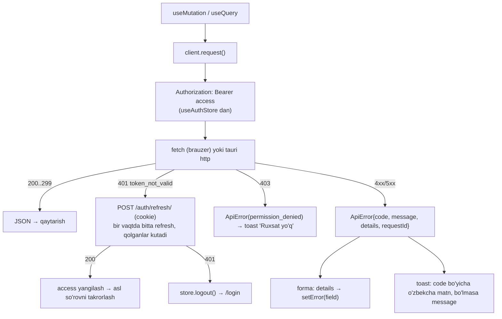

# Arxitektura (frontend)

> Holat: 1–7-bosqich amalga oshirildi (`app/`, `shared/` jumladan `shared/realtime/`, `features/{auth,settings,audit,dashboard,catalog,currency,inventory,purchasing,sales,payments}`); 6-bosqich: nasiya, mijozlar, smena; 7-bosqich: ko'chirish, inventarizatsiya, hisobdan chiqarish, savdo qaytarish.
> Umumiy arxitektura, ER, hodisalar va WebSocket hujjatlari backend repoda: `sevento_back/docs/`.

## 1. Stek

React 19 + TypeScript 5.9 + Vite 8 · React Router 8 · TanStack Query 5 (server holati) · Zustand 5 (mijoz holati) · Tailwind CSS 4 · React Hook Form + Zod 4 · Recharts (8-bosqich) · react-i18next (uz-Latn) · openapi-typescript (API turlari) · vite-plugin-pwa va Tauri (9-bosqich).
Testlar: Vitest + Testing Library + MSW. Lint: ESLint (flat config, feature chegaralari qoidasi) + Prettier.

Rejadan farqlar: access token `shared/api/tokenStore.ts` (React dan tashqari kichik modul) da, auth store (`features/auth/store`) uni ishlatadi — shunda `shared/api/client.ts` features ni import qilmaydi; `QueryClient` ham `shared/api/queryClient.ts` da (logout da tozalash uchun).

## 2. Papka tuzilishi (feature-based)

```
sevento_front/
├── src/
│   ├── app/                      # ilova qobig'i
│   │   ├── providers/            # QueryClientProvider, I18nProvider, RealtimeProvider, Toaster
│   │   ├── router/               # routes.tsx, RequireAuth, RequireCapability, lazy sahifalar
│   │   ├── layout/               # AppShell, Sidebar (menyu huquq bo'yicha), Topbar, BranchSwitcher, ConnectionIndicator
│   │   └── App.tsx
│   ├── shared/                   # sohaga bog'liq bo'lmagan umumiy kod
│   │   ├── api/
│   │   │   ├── client.ts         # yagona fetch klient: Bearer, refresh, 401/403, xato → ApiError, Idempotency-Key
│   │   │   ├── schema.d.ts       # openapi-typescript GENERATSIYA qiladi — qo'lda tahrirlanmaydi
│   │   │   ├── types.ts          # schema dan qulay alias lar: type Sale = components['schemas']['Sale']
│   │   │   ├── queryKeys.ts      # barcha query kalitlari bir joyda (invalidate xaritasi shu kalitlarga tayanadi)
│   │   │   └── errors.ts         # ApiError, xato kodlari → o'zbekcha matn
│   │   ├── realtime/
│   │   │   ├── client.ts         # RealtimeClient: ticket, auth xabari, ping/pong, backoff, holat
│   │   │   ├── invalidation.ts   # type → queryKey[] xaritasi (+ debounce)
│   │   │   └── useRealtimeStatus.ts
│   │   ├── ui/                   # Button, Input, Select, Combobox, Modal, Drawer, DataTable, Pagination,
│   │   │                         # FormField, DatePicker, MoneyInput, QuantityInput, Badge, EmptyState, Skeleton, Toast
│   │   ├── lib/                  # money.ts (Decimal satrlar, formatlash), date.ts, cn.ts, download.ts
│   │   ├── hooks/                # useDebounce, usePagination, useCapability
│   │   ├── config/               # env.ts (VITE_API_URL, VITE_WS_URL), constants
│   │   └── i18n/                 # index.ts, locales/uz/{common,auth,catalog,...}.json
│   ├── features/
│   │   ├── auth/                 # api/ hooks/ components/ pages/ store/ (useAuthStore: access token, user, capabilities)
│   │   ├── dashboard/
│   │   ├── catalog/              # tovarlar, kategoriyalar, narxlar
│   │   ├── currency/
│   │   ├── inventory/            # qoldiq, harakatlar, ko'chirish, inventarizatsiya, hisobdan chiqarish
│   │   ├── purchasing/           # yetkazib beruvchi, kirim
│   │   ├── sales/                # POS, savdolar, qaytarish, chek
│   │   ├── payments/             # mijozlar, qarzlar, to'lovlar, kassa, smena
│   │   ├── reports/
│   │   └── settings/             # foydalanuvchilar, rollar, nuqtalar, valyuta, to'lov turlari, tizim sozlamalari
│   ├── main.tsx
│   └── vite-env.d.ts
├── public/                       # ikonkalar, manifest resurslari
├── src-tauri/                    # 9-bosqichda
├── docs/
├── index.html
├── vite.config.ts                # dev proxy: /api, /ws → backend
├── tailwind.config.ts
├── tsconfig.json
├── .env.example
└── package.json
```

Har `features/<soha>/` ichida:

```
api/          # faqat shu yerda so'rovlar: sales.api.ts (client ga murojaat) + hooks: useSales(), useCompleteSale()
components/   # shu sohaga xos komponentlar (SaleItemsTable, PaymentSplitForm)
pages/        # route sahifalari (SalesListPage, PosPage, SaleDetailPage)
hooks/        # soha mantig'i (usePosCart)
types.ts      # faqat UI ga xos turlar (forma holati); API turlari shared/api/types.ts dan
index.ts      # tashqariga ochiq eksportlar
```

Qoidalar:

- Komponent ichida `fetch`/`axios` **yo'q**. Faqat `features/*/api/` dagi TanStack Query hooklari.
- `features/A` `features/B` ning ichki fayllarini import qilmaydi — faqat `features/B/index.ts` orqali (ESLint `import/no-restricted-paths` bilan tekshiriladi).
- `shared/` `features/` ni import qilmaydi.
- API turlari qo'lda yozilmaydi: `npm run gen:api` → `shared/api/schema.d.ts`. CI da sxema bilan farq bo'lsa xato.

## 3. API klient



- `client.ts` — yupqa `fetch` o'rami (axios shart emas). `credentials: 'include'` faqat `auth/*` endpointlarida.
- Access token **faqat xotirada** (`useAuthStore`), localStorage/sessionStorage ga yozilmaydi. Ilova ochilganda `POST /auth/refresh/` orqali tiklanadi; cookie bo'lmasa → login.
- Refresh — bitta "in-flight" promise; parallel 401 lar bitta refresh ni kutadi.
- Mutatsiya so'rovlarida avtomatik `Idempotency-Key` (uuid) — tarmoq uzilib takrorlanganda ikkinchi savdo yaratilmaydi.
- Tauri da `fetch` o'rniga `@tauri-apps/plugin-http` ishlatiladi (cookie jari o'zida) — `client.ts` ichida bitta adapter funksiyasi, qolgan kod o'zgarmaydi.

## 4. Autentifikatsiya va yo'nalishlar

- `useAuthStore` (Zustand): `accessToken`, `user`, `capabilities`, `branches`, `currentBranchId`, `status: 'idle'|'loading'|'authenticated'|'anonymous'`.
- `RequireAuth` — `anonymous` bo'lsa `/login?next=`; `RequireCapability cap="..."` — `/403`.
- Sidebar menyusi `capabilities` bo'yicha filtrlanadi; `BranchSwitcher` faqat bir nechta nuqta bo'lsa ko'rinadi, tanlov `currentBranchId` da (localStorage ga **shu** saqlanishi mumkin — token emas).
- Rolga qarab bosh sahifa: sotuvchi → POS, omborchi → qoldiq, buxgalter → qarzlar/kassa, rahbar → dashboard.

## 5. Real vaqt

Batafsil: `sevento_back/docs/realtime.md`. Frontend tomonida:

- `RealtimeProvider` login dan keyin `RealtimeClient.connect()`, logout da `close(1000)`.
- Har xabar → `invalidation.ts` xaritasi → `queryClient.invalidateQueries(keys)`; toast/bildirishnoma kerak turlar uchun `notifications` store ga yoziladi (sarlavhadagi qo'ng'iroq).
- `ConnectionIndicator`: `connecting | online | offline`; `offline` da muhim so'rovlar `refetchInterval` bilan polling.
- Savdo: `stock.changed` kassa qidiruvini (`['sales','pos']`) ham yangilaydi — ikki kassada qoldiq sinxron; `dashboard.updated` → `['sales','summary']`, `['sales','list']`; `payment.received`/`payment.refunded` → `['payments']` (kassa qoldig'i, jurnal) va savdolar ro'yxati.
- Ombor: `stock.changed` → `['inventory']` (qoldiq, harakatlar, partiyalar bitta kalit ostida; 1,5 s debounce — ko'p qatorli kirim bitta qayta o'qish), `stock.below_minimum` → shu kalit + "Kam qoldi" toast. Qoldiq va harakatlar so'rovlari `meta.pollWhenOffline`.

## 6. Formalar va pul

- React Hook Form + Zod; Zod sxemalar `features/*/schemas.ts` da; server `details` xatolari `setError` ga.
- Pul va miqdor API da satr; UI da `decimal.js` emas — formatlash uchun `Intl.NumberFormat('uz')`, arifmetika (savat yig'indisi) uchun kichik `money.ts` (butun tiyin/sent bilan) — tannarx va yakuniy summa baribir backend dan keladi, frontend faqat ko'rsatadi.
- **Raqam va sana formati brauzer lokaliga bog'liq emas** (`shared/lib/money.ts`, `date.ts`): `12 650,45`, `22.10.2026 14:05`. Sabab: Chromium/WebKit ning ba'zi buildlarida (shu jumladan Tauri ishlatadigan WebKitGTK) `uz` lokali yo'q va `Intl` jim ingliz formatiga qaytadi. Kasr xonalari valyuta jadvalidan (`decimal_places`), kodda qattiq yozilmaydi. Kiritilgan sonlar `parseDecimalInput` bilan (bo'sh joy va vergul qabul qilinadi).
- `MoneyInput` valyuta belgisi va kasr soni bilan; `QuantityInput` birlikning `decimal_places` ga qarab.
- API dan kelgan son forma maydoniga `toDecimalInput` bilan qaytadi (`"25.500"` → `25,5`).
- Hujjat qatorlari (kirim, keyin savdo/ko'chirish): `useFieldArray`; tovar `ProductPicker` (`shared/ui/Combobox` asosida, `@/features/catalog` dan) bilan tanlanadi. Forma turlari `z.input` (tovar hali tanlanmagan — `null`) va `z.output` (tekshiruvdan keyin) ga ajratiladi. Qator summasi mijozda faqat ko'rsatish uchun; tannarx va yakuniy summa — `GET purchases/<id>/preview/` (server) dan. Birlik aniqligi (dona 0, kg 3 xona) mijozda ham, serverda ham tekshiriladi.

### Kassa (POS)

- Savat — Zustand store, `sessionStorage` da (sahifa yangilansa yo'qolmaydi; sir yo'q). Nuqta, valyuta yoki narx turi o'zgarsa tozalanadi; sahifa qayta ochilganda narx va qoldiq `GET sales/pos-products/?ids=` bilan yangilanadi.
- Hisob-kitob (`features/sales/lib/money.ts`) — BigInt bilan, serverdagi qoidalarning aniq nusxasi: qator = yaxlitlash(miqdor × narx) − chegirma; to'lov valyutasi → savdo valyutasi 4 xona; qaytim pastga yaxlitlanadi. Ekrandagi jami `expected_total` sifatida yuboriladi (narx o'zgargan bo'lsa server 409 qaytaradi, savat yangilanadi).
- Shtrix-kod skaneri: raqamlar + Enter → `?barcode=` aniq qidiruv. F2 — qidiruv, F9 — to'lov.
- To'lov oynasi: bir nechta qator (to'lov turi × valyuta), "Qolganini" tugmasi boshqa valyutada kerakli summani yuqoriga yaxlitlab qo'yadi; ortiqcha summa faqat naqd bo'lsa (qaytim naqd beriladi). Har urinishga bitta `Idempotency-Key` (tarmoq uzilib qayta yuborilsa ikkinchi savdo bo'lmaydi).
- Chek: PDF `api.blob()` (Authorization bilan) → yashirin iframe → brauzer chop etish oynasi (`shared/lib/print.ts`); "avtomatik chop etish" — har kassir uchun `localStorage` da (qulaylik).
- Menyu: faol band — eng uzun mos keladigan yo'l (`/sales/pos` da faqat "Kassa").
- Kassa sozlamalari (boshlang'ich valyuta, narx turi) yuklanmaguncha POS ochilmaydi (`PosLoader`) va tanlangan valyuta savatga qotiriladi — aks holda tovar bir valyutada olinib, boshqasida ko'rsatilishi mumkin edi (e2e da topilgan xato).
- Nasiya: mijoz `CustomerPicker` (`@/features/payments`) bilan tanlanadi, kredit holati mijoz kartasidan (`useCustomer`). To'lov oynasida qolgan summa nasiyaga ("Nasiyaga"), muddat ixtiyoriy (bugundan oldin emas); mavjud limit savdo valyutasiga BigInt bilan o'tkaziladi va oshsa tugma yopiladi (server baribir 409 qaytaradi).

### Nasiya va kassa (6-bosqich)

- Mijoz kartasi: kredit limiti / ishlatilgan / mavjud (asosiy valyutada), valyuta bo'yicha qarz qoldig'i, ochiq qarzlar, akt-sverka (`CustomerLedgerEntry`).
- Qarz to'lovi oynasi: "Hammasini" summasini server hisoblaydi (`GET customers/<id>/payoff/`) — boshqa valyutada yaxlitlash xatosi bo'lmasin; har ochilishga bitta `Idempotency-Key`.
- BigInt yordamchilari `shared/lib/decimal.ts` da (POS va to'lovlar uchun umumiy).
- Realtime: `payment.received`, `debt.changed`, `cash.updated` → `['payments']` (mijoz kartasi, qarzlar, kassa jonli); `debt.overdue`, `customer.credit_limit_warning` → toast (faqat `debts.manage` huquqi borlarga keladi).

### Ombor hujjatlari va qaytarish (7-bosqich)

- `features/inventory/api/documents.api.ts` — ko'chirish, inventarizatsiya, hisobdan chiqarish hooklari; kalitlar `['inventory', ...]` ostida, shuning uchun `stock.changed` va `transfer.*` ularni bitta invalidate bilan yangilaydi.
- Ko'chirish sahifasi bitta (`TransferPage`): qoralama va tahrirlash huquqi bo'lsa — muharrir (qatorlar `LinesEditor`, "Saqlash va jo'natish"), aks holda — ko'rinish (qabul oynasi, bekor qilish). Tugmalar serverdagi `allowed` maydonidan. Qabul qiluvchi nuqta ro'yxati — `GET inventory/transfers/destinations/` (omborchi o'z nuqtasidan boshqasini ham tanlay olishi uchun).
- Menyuda "Ko'chirishlar" yonida qabul kutilayotganlar soni (`useNavBadges` — app qatlamida, ombor chunk ini asosiy bundle ga tortmaslik uchun).
- Toastlar `app/providers/transferNotice.ts` (sof funksiya, test bilan): jo'natildi → qabul qiluvchi nuqta omborchisiga, qabul qilindi → jo'natuvchiga (farq bo'lsa ogohlantirish, rahbarga ham), jo'natilgani bekor qilindi → qabul qiluvchiga; o'z amali haqida toast yo'q. Bir xabar ikki guruhdan kelsa `RealtimeClient` uni `id` bo'yicha bir marta uzatadi.
- Inventarizatsiya: kiritishlar sahifalar orasida saqlanadi (tovar id → qiymat), "Saqlash" bitta so'rov; qoralamada farq = sanalgan − hozirgi qoldiq (BigInt), Enter — keyingi qatorga (skaner bilan tez sanash).
- Qaytarish oynasi (`features/sales/components/ReturnModal.tsx`): summa `lib/returns.ts` da server formulasining aniq nusxasi (`round(L·(r+q)/Q) − round(L·r/Q)`), avval qarzdan, qolgani pul (taxminiy; yakuniy — server). Qaytarish bo'lgan savdoda "Bekor qilish" ko'rinmaydi.
- Hujjat havolalari (`purchase`, `sale`, `sale_return`, `transfer`, `stock_count`, `write_off`, `customer`) — `shared/lib/documentRoutes.ts` (harakatlar jurnali, kassa, to'lovlar).

## 7. i18n

- `react-i18next`, hozir `uz` (lotin). Matnlar sohalar bo'yicha namespace: `common`, `auth`, `catalog`, `sales`, ...
- Kodda qattiq matn yo'q (ESLint `i18next/no-literal-string` ogohlantirish bilan). Yangi til = `locales/<kod>/` papkasi.
- Sana/raqam formatlari `Intl` orqali, til bilan birga o'zgaradi.

## 8. PWA va Tauri (9-bosqich)

- `vite-plugin-pwa`: manifest (nom, ikonkalar, `standalone`), service worker faqat ilova qobig'i (shell) va statik fayllar uchun; API javoblari keshlanmaydi (ma'lumot manbai doim server). Offline da "Internet yo'q" ekrani.
- Tauri: `src-tauri/` shu kod bazasini o'raydi; `VITE_API_URL` buildda to'liq manzil; HTTP — plugin-http; yangilanish uchun `tauri-plugin-updater` keyinroq.
- Alohida mobil/desktop kod yo'q — ekranlar responsive (POS planshetda ishlashi kerak).

## 9. Build va skriptlar

| Skript | Nima qiladi |
|---|---|
| `npm run dev` | Vite, `/api` va `/ws` ni `VITE_PROXY_TARGET` (default `http://localhost:8000`) ga proxy |
| `npm run gen:api` | `openapi-typescript` → `src/shared/api/schema.d.ts` (manba: `OPENAPI_URL` yoki `../sevento_back/docs/api/openapi.yaml`) |
| `npm run typecheck` / `lint` / `test` | tsc, eslint, vitest |
| `npm run build` | production build (Docker da Nginx tarqatadi) |
| `npm run tauri dev/build` | 9-bosqichdan |

Docker: ko'p bosqichli `Dockerfile` (node build → nginx), `nginx.conf` `/api/` va `/ws/` ni `backend:8000` ga proxy qiladi (WS upgrade bilan). Backend repodagi `docker-compose.yml` shu Dockerfile ni ishlatadi.
